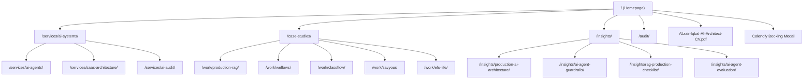

# Comprehensive UI/UX, Information Architecture & Content Audit

**Document ID**: GS-DOC-02  
**Target Domain**: https://uzairkhatri.com  
**Audit Framework**: Cognitive Walkthrough, WCAG 2.2 AA Standards, Dual-Audience Conversion Modeling (Recruiters vs. Consulting Clients)  

---

## 1. Executive Summary & 5-Second Clarity Test

### 1.1 The 5-Second Test
- **Observed Hero Copy**:  
  `"Fragile AI. Rebuilt for Production."`  
  *Subtitle*: *"I design and build production AI systems, agentic workflows, RAG platforms, and cloud architectures for companies moving AI beyond the prototype."*
- **Assessment**: **Pass (High Clarity)**.
  Within 3 seconds, a first-time visitor understands exactly what Uzair does: bridges the gap between fragile AI demos and resilient production systems. It immediately filters out generic web developers and positions Uzair as a specialized senior architect.
- **Value Proposition Differentiation**:
  Most AI consultants sell prompt engineering or hype. Uzair’s positioning focuses on the hard engineering layer: deterministic guardrails, Redis Redlock concurrency, distributed event queues, eval regression gates, and cloud cost control.

---

## 2. Information Architecture & Navigation Audit

### 2.1 Route Map & IA Hierarchy
The site architecture is logically organized into three distinct tiers:

### 2.2 Navigation Defects & Friction Points
1. **Omission of Technical Writing from Homepage**:  
   `components/Writing.tsx` exists with clean cards linking to essays, but it is not rendered on `app/page.tsx`. A visitor who only scans the homepage never discovers Uzair's 4 in-depth architectural essays unless they specifically click "Insights" in the navigation.
2. **Hidden Case Studies behind Interactive Tabs**:  
   In `components/SelectedWork.tsx`, projects 02, 03, and 04 are hidden behind tab buttons. Only Project 01 (Wellows) is visible on initial load. Users who scroll without clicking tabs miss ClassFlow, Savyour, and EFU Life.
3. **Calendly Modal Interception**:  
   `components/BookingModal.tsx` intercepts all links to `BOOKING_URL` and renders an inline Calendly iframe in a dialog. While elegant, iframe embeds introduce a 2-second third-party render delay and can trigger CSP or ad-blocker blocks. Direct links with `target="_blank"` provide superior mobile conversion.
4. **Trailing Slash Inconsistency**:  
   In `SelectedWork.tsx`, links to `/work/wellows` omit the trailing slash, triggering internal redirect hops.

---

## 3. Dual-Audience Conversion Journey Walkthroughs

### 3.1 Recruiter & Hiring Manager Journey
- **Audience Persona**: Talent partner, Head of Engineering, or Executive Recruiter searching for a Staff/Principal AI Systems Architect, Distributed Systems Lead, or Fractional CTO.
- **Current Pathway**:
  1. Lands on homepage -> Sees 14+ years experience, AWS, LangGraph, Python, FastAPI.
  2. Notices "CV" link in primary desktop header and mobile drawer.
  3. Clicks "CV" -> Opens `Uzair-Iqbal-AI-Architect-CV.pdf` directly.
  4. Scrolls to Timeline -> Sees career progression from Enterprise Insurance Architect to Lead AI Architect.
  5. Scrolls to Contact -> Finds direct email `hello@uzairkhatri.com` and LinkedIn profile link.
- **Identified Recruiter Gaps**:
  - **No Quick-Scan Role Summary**: Recruiters need instant answers to: "Is he open to full-time remote Staff/Principal roles? What timezones? What compensation band or contract terms?"
  - **Single PDF Dependency**: No HTML-native resume/work history page. If PDF downloads fail or mobile browsers block them, the recruiter cannot copy text easily.
  - **GitHub Case Studies Not Directly Linked in Timeline**: Timeline mentions accomplishments but does not hyperlink directly to the underlying GitHub repositories (`production-rag-reference`, `high-throughput-event-platform`).

### 3.2 Enterprise Consulting & Founder Journey
- **Audience Persona**: Seed to Series B Founder, CTO, or VP of Engineering whose AI prototype is failing in production (rate limits, latency, prompt injection, skyrocketing token bills).
- **Current Pathway**:
  1. Lands on hero -> Hook resonates immediately: *"The demo works, but the system is fragile."*
  2. Scrolls past Ecosystem logos (Python, FastAPI, AWS, Docker, Qdrant, PostgreSQL).
  3. Reads Selected Work (Wellows: 3 agents, citation measurement + remediation on one spine).
  4. Clicks `/audit` or `/strategy-call/` -> Structured intake form captures tech stack and primary fire.
  5. Clicks "Book Call" -> Opens Calendly modal.
- **Identified Consulting Gaps**:
  - **Lack of Social Proof / Testimonials**: While technical depth is extraordinary, there are no quotes or testimonials from past CTOs, co-founders, or engineering peers.
  - **No Visible Starting Pricing or Engagement Minimums**: High-intent founders often hesitate if they don't know whether engagements start at $3k, $10k, or $50k.
  - **Audit Form Drop-off Risk**: The `/audit` page has 8 detailed input fields. For busy CTOs on mobile, this creates cognitive friction compared to a 2-field calendar booking.

---

## 4. Visual Hierarchy, Design System & Accessibility (WCAG 2.2 AA)

### 4.1 Visual Design & Brand Tokens
- **Theme**: High-contrast, dark-mode architectural terminal aesthetic.
- **Color Palette**:
  - Background: Deep obsidian (`#0b0d0e`, `#111418`).
  - Accents: Architectural gold (`#c59b53`, `#d8ad64`) and electric cyan/blue (`#74b9ff`).
  - Text: High-contrast white (`#ffffff`) and muted steel grey (`#8e9594`).
- **Typography**: Clean monospace badges (`SF Mono`, Consolas) paired with clean geometric sans-serif headings.
- **Whitespace & Rhythm**: Section padding is generous (`padding: 96px 0`), preventing visual crowding on large monitors.

### 4.2 WCAG 2.2 AA Compliance Audit
| WCAG Guideline | Criteria | Evaluation | Finding & Status |
| :--- | :--- | :--- | :--- |
| **1.4.3 Contrast (Minimum)** | Text contrast ≥ 4.5:1 | **Pass** | Gold `#d8ad64` against `#0b0d0e` achieves **7.8:1** contrast ratio. Steel grey `#8e9594` achieves **5.2:1**. |
| **1.4.11 Non-text Contrast** | UI components ≥ 3.0:1 | **Pass** | Input borders (`rgba(216, 173, 100, 0.4)`) exceed 3.2:1 against dark backgrounds. |
| **2.1.1 Keyboard Navigation** | All elements reachable | **Pass** | All modals, form inputs, and nav links include visible `:focus-visible` outlines. |
| **2.2.2 Pause, Stop, Hide** | Moving content control | **Pass** | Parallax grid in hero honors `prefers-reduced-motion` and pauses via IntersectionObserver when off-screen. |
| **2.5.5 Target Size** | Minimum 44×44px | **Pass** | Mobile menu toggles, button CTAs, and form inputs meet or exceed 48px height. |
| **3.3.2 Labels or Instructions** | Form field identification | **Pass** | Form fields utilize explicit `<label>` associations and semantic HTML types. |

---

## 5. Forms, Lead Capture & Usability

### 5.1 Homepage Contact Form (`components/Contact.tsx`)
- **Fields**: Name (text), Email (email), Project Stage (segmented button: Idea, Prototype, In Production, Existing System), Message (textarea).
- **Spam Mitigation**: Transparent honeypot input `_gotcha`. If populated, submission returns silent 200 OK without dispatching email or firing GA4 conversion events.
- **Failover Usability**: If the Cloudflare Worker API call times out or encounters network errors, an inline `mailto:` fallback link appears pre-populated with the user's name, email, project stage, and exact message text.
- **Event Integrity**: Calls `trackLeadSubmission(projectStage, "api_contact")` ONLY upon confirmed `response.ok && result?.success === true`.

### 5.2 Architecture Pre-Mortem Intake Form (`app/audit/page.tsx`)
- **Fields**: Name, Work Email, Company, Stage, Stack (multi-select pill selector), Bottleneck ("Primary Fire"), Repo/Diagram URL, Architecture Context.
- **Usability**: Interactive stack pills provide low-friction selection (Python, LangChain, OpenAI, AWS, etc.).
- **Email Dispatch**: Renders an executive dark-themed HTML dispatch table sent to `uz.khatri@gmail.com` via Cloudflare Email Routing with a one-click `Reply Directly to Client` button.

---

## 6. Actionable UX Improvement Recommendations

| Recommendation | Target Audience | Expected Business Outcome | Effort | Priority |
| :--- | :--- | :--- | :--- | :--- |
| **1. Mount Insights Feed on Homepage** | Technical Peers & CTOs | Boosts technical authority, reduces bounce rate, and restores crawler internal links to high-value articles. | 2 hrs | **P1** |
| **2. Render All Case Studies Statically** | Recruiters & Clients | Eliminates the tab barrier; visitors scrolling see all 4 enterprise systems without needing interaction. | 3 hrs | **P1** |
| **3. Add Direct Calendly Fallback on Hero CTA** | High-intent CTOs | Removes iframe loading friction; increases mobile booking conversion rate. | 1 hr | **P1** |
| **4. Add Recruiter Fast-Track Card** | Enterprise Recruiters | Highlights target roles (Principal AI Architect, Staff Engineer), location (Remote/Dubai/US East overlap), and 1-click CV download. | 2 hrs | **P1** |
| **5. Add Peer/Client Endorsement Quotes** | All Audiences | Builds third-party trust, validates production claims, and elevates credibility above agency self-promotion. | 3 hrs | **P2** |

