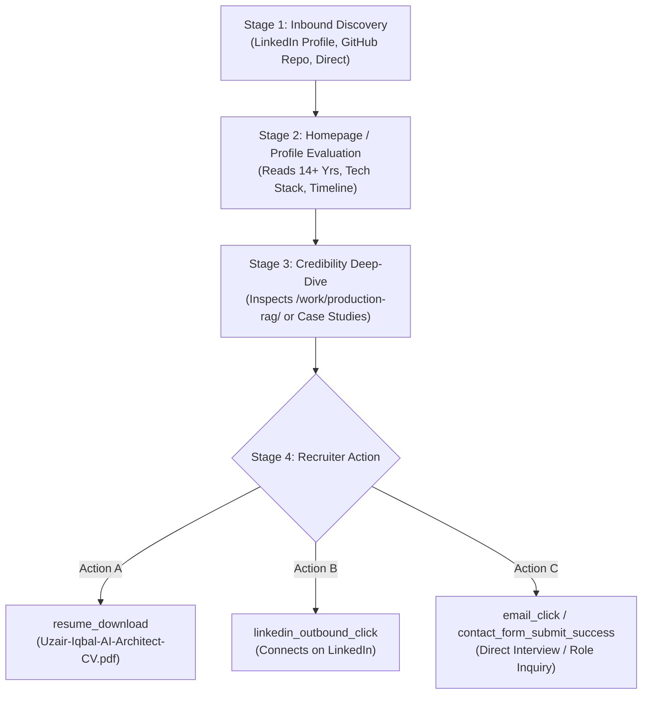
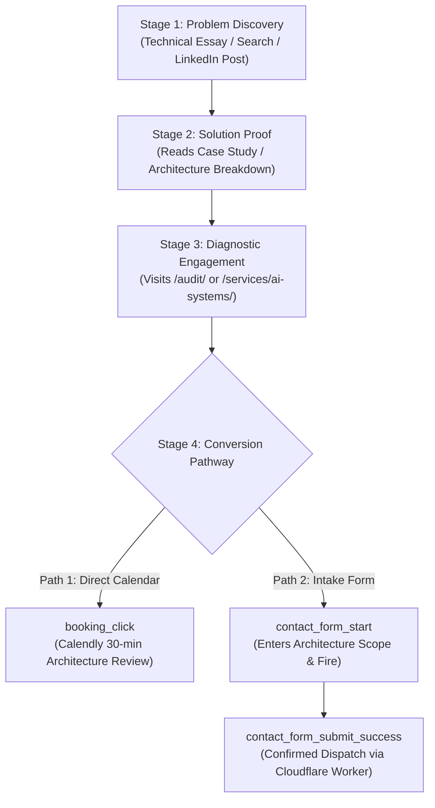

# Analytics Measurement, Event Schema & Funnel Attribution Specification

**Document ID**: GS-DOC-05  
**Target Properties**:  
- Google Analytics 4: Measurement ID `G-1LXS5Z6GJ6` (Property ID `553870935`)  
- Google Search Console: `sc-domain:uzairkhatri.com`  
**Auditor**: Analytics Engineer & Technical Growth Architect  
**Status**: Proposal Specification (Awaiting Approval — Zero Tracking Injected)  

---

## 1. Audit of Existing Analytics Setup

### 1.1 Current Architecture (`components/analytics.ts` & `SiteAnalytics.tsx`)
- **Initialization**: Triggered only on HTTPS `uzairkhatri.com` and `www.uzairkhatri.com`. Localhost, staging, and IP hosts strictly blocked.
- **Opt-Out Control**: Supports manual testing bypass via `?analytics=off`, setting `portfolio-analytics-disabled=true` in local storage and triggering Google’s `ga-disable-G-1LXS5Z6GJ6` flag.
- **Existing Custom Events in Code**:
  1. `generate_lead`: Emitted on successful contact form submission (`components/Contact.tsx`).
  2. `audit_request`: Emitted on successful audit intake submission (`app/audit/page.tsx`).
  3. `booking_click`: Emitted on clicks pointing to `https://calendly.com/uz-khatri/30min`.
  4. `case_study_click`: Emitted on internal navigation to `/work/<slug>`.

### 1.2 Identified Analytics Limitations & Blind Spots
1. **Recruiter Journey Blindness**: When a recruiter clicks "CV" in the navbar or downloads `/Uzair-Iqbal-AI-Architect-CV.pdf`, GA4 records an uninformative default `file_download` event without recruiter context.
2. **Outbound Developer Blindness**: Clicks to GitHub repositories and LinkedIn profiles are completely uninstrumented as custom conversion signals.
3. **Form Drop-Off Blindness**: No event tracks when a user starts filling out the contact form or audit form (`contact_form_start`), making it impossible to calculate form abandonment rates.
4. **Single-Page Application (SPA) Transition Gaps**: When visitors navigate between Next.js pages client-side, individual case studies lack a dedicated `case_study_view` event with explicit metadata (`case_study_name`, `architecture_type`, `read_depth`).

---

## 2. Event Measurement Specification & Schema Mapping

To prevent data corruption, double-counting, or breaking existing reports, all proposed events are mapped to existing codebase functions:

| Standard Business Event | Codebase Mapping / Status | Trigger Condition | Required Event Parameters | Conversion Classification |
| :--- | :--- | :--- | :--- | :--- |
| `page_view` | Native GA4 Enhanced Measurement | Standard Next.js route change / load | `page_title`, `page_location`, `page_path` | Engagement |
| `recruiter_cta_click` | **New Proposed Event** | Click on "CV", "Download Resume", or recruiter fast-track links | `cta_location` (`nav`, `contact`, `hero`), `link_url` | High-Intent Recruiter |
| `resume_download` | **New Proposed Event** (Specializes `file_download`) | Activation of link pointing to `/Uzair-Iqbal-AI-Architect-CV.pdf` | `file_name`, `link_url`, `source_section` | Primary Recruiter Conversion |
| `github_outbound_click` | **New Proposed Event** | Clicks pointing to `github.com/uzairkhatri/*` | `destination_repo`, `source_page`, `link_text` | Technical Peer Engagement |
| `linkedin_outbound_click`| **New Proposed Event** | Clicks pointing to `linkedin.com/in/uzair-khatri` | `source_section`, `link_location` | Professional Engagement |
| `consultation_click` | Maps to existing `booking_click` | Click on Calendly booking link or modal button | `source` (`hero`, `nav`, `services`, `footer`), `page_path` | Primary Client Intent |
| `contact_form_start` | **New Proposed Event** | First focus or input change in contact or audit form | `form_type` (`contact_general`, `audit_premortem`) | Funnel Progression |
| `contact_form_submit_success` | Maps to existing `generate_lead` & `audit_request` | **Confirmed HTTP 200** with `result.success === true` | `lead_type`, `method`, `stack`, `value: 1` | **Verified Primary Conversion** |
| `email_click` | **New Proposed Event** | Activation of any `mailto:hello@uzairkhatri.com` link | `source_section`, `page_path` | Secondary Lead Intent |
| `case_study_view` | **New Proposed Event** | Full load / view of any individual `/work/<slug>/` page | `case_study_slug`, `tech_stack`, `scroll_depth` | High-Intent Evaluation |

---

## 3. Strict Conversion Integrity Rules

### 3.1 Confirmed Success vs. Submit Attempt
- **No Vanity Counting**: Clicking a "Submit" or "Send Message" button **NEVER** fires a conversion event.
- **Bot Filtering**: If the hidden honeypot `_gotcha` field is populated, the form silently displays a success message to deceive the bot, but **no conversion event is emitted** to Google Analytics.
- **Network Failure Handling**: If the Cloudflare Worker API returns an HTTP 400, 500, or network abort, an error state is displayed and **zero conversion events fire**.

### 3.2 Duplicate Prevention & Capture Listener
- A single global event capture listener attached to `document` handles link tracking (`components/analytics.ts:trackLinkClick`).
- Individual components must never attach redundant `onClick` tracking listeners to the same anchor tags.
- Middle clicks (`auxclick`, button 1), keyboard activations, and right-click behaviors are normalized so each user intent is recorded exactly once.

---

## 4. Dual Conversion Funnel Architectures

### 4.1 The Enterprise Recruiter Funnel



### 4.2 The Enterprise Consulting & Architecture Client Funnel



---

## 5. UTM Tracking Taxonomy & Governance

To ensure clean channel attribution in GA4 `sessionSourceMedium` reports, all external campaign links must adhere to this strict taxonomy:

```text
https://uzairkhatri.com/<target_page>/?utm_source=<source>&utm_medium=<medium>&utm_campaign=<campaign>&utm_content=<content>
```

### 5.1 Permitted UTM Values:
- **`utm_source`**: `linkedin`, `github`, `twitter`, `newsletter`, `medium`, `upwork`.
- **`utm_medium`**: `social` (posts), `profile` (bio/about), `readme` (GitHub markdown), `article` (newsletters/long-form), `featured` (LinkedIn featured cards).
- **`utm_campaign`**:
  - `rag_reference` (Content tied to production RAG)
  - `ai_audit` (Content promoting the 2-week pre-mortem sprint)
  - `agent_guardrails` (Multi-agent orchestration breakdowns)
  - `event_platform` (Distributed backends & high-throughput systems)
  - `profile_brand` (General biographical & resume links)
- **`utm_content`**: Optional identifier for specific variant (e.g., `carousel_v1`, `post_01_hook`, `readme_banner`).

---

## 6. Data Privacy, Consent & Internal Traffic Exclusions

1. **IP Masking & Anonymization**: Handled natively by GA4. No PII (names, raw emails, phone numbers, or free-form message text) is passed to Google Analytics parameters.
2. **Testing Filter**: Development and manual testing must navigate via `https://uzairkhatri.com/?analytics=off` to ensure developer visits do not pollute production analytics.
3. **Data Retention**: Recommend setting GA4 event data retention to the maximum allowed: **14 months** (default is often 2 months, which blinds annual trend comparisons).

