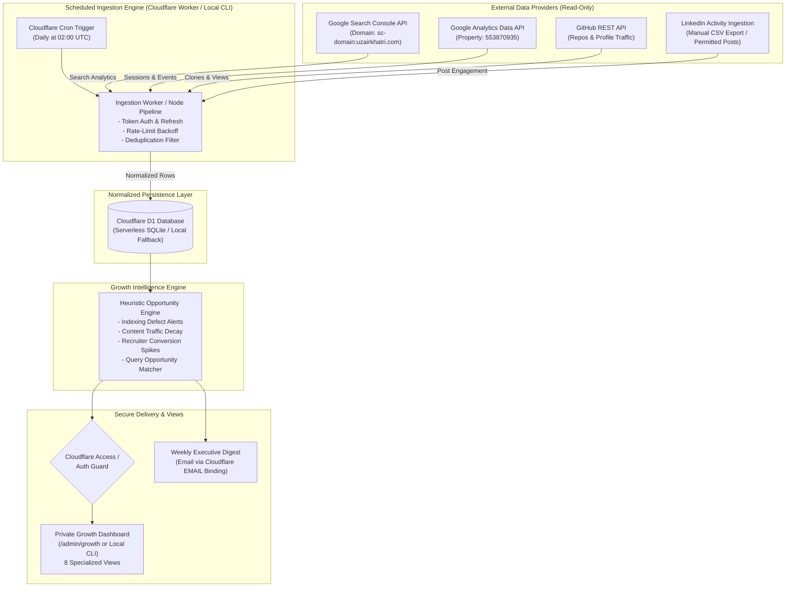

# Growth Intelligence System: Technical Architecture & System Design

**Document ID**: GS-DOC-06  
**Target Domain**: https://uzairkhatri.com  
**Auditor**: Senior Full-Stack Architect & Analytics Engineer  
**Architecture Standard**: Cloudflare Edge-Native, Zero-Maintenance, Free-Tier Compatible  

---

## 1. System Vision & Design Principles

The Personal Brand Growth & Intelligence System is an automated, evidence-driven telemetry and decision platform. Rather than relying on sporadic, manual audits or vanity metrics, this system automatically ingests, normalizes, stores, and evaluates discovery signals across Google Search Console, Google Analytics 4, GitHub, and LinkedIn to generate high-leverage growth opportunities.

### Core Architectural Principles:
1. **Zero New Infrastructure Overhead**: Operates entirely within Uzair’s existing Cloudflare Workers + Static Assets architecture.
2. **Zero Operational Cost**: Uses existing free tiers of Cloudflare (Workers, Cron Triggers, D1/KV), Google Cloud APIs, and GitHub REST APIs ($0/month incremental cost).
3. **Idempotency & Data Freshness**: Ingestion pipelines support safe replays for any date window without duplicating historical rows.
4. **Least Privilege & Strict Privacy**: Ingestion connectors use read-only OAuth scopes; all credentials remain server-side; zero secrets in client code.
5. **Authenticated Isolation**: The private dashboard and intelligence endpoints are protected behind Cloudflare Access or cryptographic token authorization, completely decoupled from public portfolio pages.

---

## 2. High-Level Architecture Diagram



---

## 3. Data Connectors & Ingestion Pipeline Specification

### 3.1 Connector Specification Matrix

| Connector | Source Endpoint / Scope | Auth Method | Schedule & Cadence | Rate Limits & Quotas | Handling Strategy |
| :--- | :--- | :--- | :--- | :--- | :--- |
| **GSC Connector** | `searchAnalytics/query`, `urlInspection/index:inspect` | Google Service Account JWT (`webmasters.readonly`) | Daily at 02:00 UTC (T-3 days to account for GSC processing latency) | 1,200 QPM; 100,000 QPD | Batch query with date pagination; idempotent upsert by `(date, query, page)`. |
| **GA4 Connector** | `analyticsdata.googleapis.com/v1beta/properties:runReport` | Google Service Account JWT (`analytics.readonly`) | Daily at 02:00 UTC (T-1 day finalized metrics) | 25,000 tokens per day | Fetches sessions, channels, landing pages, and custom conversion events; upserts by `(date, source_medium, page_path)`. |
| **GitHub Connector** | `api.github.com/repos/uzairkhatri/*/traffic/views` | GitHub PAT (`repo` read scope) | Daily at 02:30 UTC | 5,000 requests/hr | Polls views, clones, and popular paths; saves rolling 14-day history before GitHub purges it. |
| **LinkedIn Connector** | Authorized Post Export CSV or manual intake JSON | Local structured file parser | Weekly / Monthly on publish | Platform restricted | Local CLI command `npm run growth:import-linkedin` ingests post impressions, reactions, and comments. |

### 3.2 Ingestion Engine Guarantees
- **Date-Window Consistency**: Ingested dates are stamped in ISO-8601 UTC. GSC queries run with an explicit 3-day lag window (`endDate = today - 3 days`) to avoid partial-day fluctuations.
- **Idempotency**: All database tables enforce composite primary keys (e.g. `PRIMARY KEY (date, metric_source, dimension_key)`). Ingestion uses SQLite `INSERT OR REPLACE` to ensure rerun safety.
- **Retry with Exponential Backoff**: Failed HTTP calls retry up to 3 times with exponential backoff and jitter (`delay = 2^attempt * 500ms + random()`).

---

## 4. Normalized Data Model (Cloudflare D1 / SQLite Schema)

```sql
-- Daily aggregate discovery metrics
CREATE TABLE IF NOT EXISTS daily_traffic_summary (
    date TEXT NOT NULL,
    total_users INTEGER NOT NULL,
    new_users INTEGER NOT NULL,
    sessions INTEGER NOT NULL,
    pageviews INTEGER NOT NULL,
    engagement_duration_seconds INTEGER NOT NULL,
    gsc_impressions INTEGER NOT NULL DEFAULT 0,
    gsc_clicks INTEGER NOT NULL DEFAULT 0,
    gsc_average_position REAL,
    booking_clicks INTEGER NOT NULL DEFAULT 0,
    resume_downloads INTEGER NOT NULL DEFAULT 0,
    leads_generated INTEGER NOT NULL DEFAULT 0,
    audit_requests INTEGER NOT NULL DEFAULT 0,
    updated_at TEXT NOT NULL,
    PRIMARY KEY (date)
);

-- Search Console detailed query & page performance
CREATE TABLE IF NOT EXISTS search_performance (
    date TEXT NOT NULL,
    query TEXT NOT NULL,
    page TEXT NOT NULL,
    country TEXT NOT NULL,
    device TEXT NOT NULL,
    impressions INTEGER NOT NULL,
    clicks INTEGER NOT NULL,
    ctr REAL NOT NULL,
    position REAL NOT NULL,
    PRIMARY KEY (date, query, page, country, device)
);

-- Traffic channel & acquisition source performance
CREATE TABLE IF NOT EXISTS traffic_acquisition (
    date TEXT NOT NULL,
    channel_group TEXT NOT NULL,
    source_medium TEXT NOT NULL,
    campaign TEXT NOT NULL DEFAULT 'none',
    sessions INTEGER NOT NULL,
    active_users INTEGER NOT NULL,
    engagement_rate REAL NOT NULL,
    PRIMARY KEY (date, source_medium, campaign)
);

-- Event telemetry & funnel tracking
CREATE TABLE IF NOT EXISTS funnel_events (
    date TEXT NOT NULL,
    event_name TEXT NOT NULL,
    funnel_type TEXT NOT NULL, -- 'recruiter', 'consulting', 'peer'
    source_section TEXT,
    event_count INTEGER NOT NULL,
    PRIMARY KEY (date, event_name, source_section)
);

-- Experiment backlog & outcome tracking
CREATE TABLE IF NOT EXISTS growth_experiments (
    experiment_id TEXT PRIMARY KEY,
    title TEXT NOT NULL,
    category TEXT NOT NULL, -- 'seo', 'ux', 'content', 'github', 'linkedin'
    hypothesis TEXT NOT NULL,
    target_metric TEXT NOT NULL,
    baseline_value REAL NOT NULL,
    status TEXT NOT NULL, -- 'backlog', 'active', 'validated', 'abandoned'
    started_at TEXT,
    completed_at TEXT,
    outcome_summary TEXT
);

-- Automated intelligence recommendations
CREATE TABLE IF NOT EXISTS intelligence_opportunities (
    id TEXT PRIMARY KEY,
    detected_at TEXT NOT NULL,
    category TEXT NOT NULL,
    severity TEXT NOT NULL, -- 'critical', 'high', 'medium', 'info'
    finding TEXT NOT NULL,
    supporting_evidence TEXT NOT NULL,
    recommended_action TEXT NOT NULL,
    status TEXT NOT NULL DEFAULT 'open' -- 'open', 'resolved', 'dismissed'
);
```

---

## 5. The Eight Specialized Dashboard Views

1. **Executive Overview**: High-level trend lines of qualified visitors, CV downloads, booking clicks, confirmed lead submissions, and 28-day vs 90-day trajectory.
2. **Search Performance (SEO Intelligence)**:
   - Queries with impressions > 5 and position between 4 and 15 (striking-distance keywords).
   - Indexed vs. unindexed subpage tracker with live GSC crawl status indicators.
3. **Acquisition & Campaigns**: Breakdown of Direct, LinkedIn Referral, GitHub Referral, and Google Organic. Real-time UTM campaign ROI tracker.
4. **Recruiter Journey**: Specialized funnel showing `CV downloads` -> `Email clicks` -> `LinkedIn outbound connects`. Identifies peak recruiter days (typically Tuesdays–Thursdays).
5. **Consulting & Advisory Journey**: High-intent path from `/audit/` and case studies to `booking_click` and confirmed `generate_lead` submissions.
6. **Technical Health & Core Web Vitals**: Real-time HTTP error status (404/500), broken internal link tracker, Edge TTFB, and Cloudflare WAF threat counters.
7. **Content & Thought Leadership Impact**: Correlation matrix linking specific LinkedIn posts or GitHub releases to spikes in website pageviews and CV downloads.
8. **Automated Opportunity Engine**: Ranked action items generated by rule-based heuristic checks (e.g. *"Article X has 200 impressions but 0 clicks: optimize meta description"*, *"Page Y has not been crawled in 45 days: ping IndexNow"*).

---

## 6. Heuristic Recommendation Engine & Anomaly Detection

To prevent alert fatigue, alerts trigger only upon mathematically verified anomalies:
- **Indexing Drop Alert**: Fired if an indexed page drops to `URL is unknown to Google`.
- **404 / Scanner Spike**: Fired if 404 response counts exceed 25 in a 24-hour period.
- **Conversion Surge**: Fired immediately upon confirmed `contact_form_submit_success` or `audit_request`.
- **Sitemap Stagnation Alert**: Fired if GSC sitemap status remains `isPending: true` for > 7 days.
- **Striking-Distance SEO Alert**: Fired when a query enters positions 5–15 with > 20 monthly impressions.

---

## 7. Operational Cost, Local Development & Testing Strategy

### 7.1 Operational Cost Estimate
- **Cloudflare Workers & Static Assets**: Free Tier ($0/mo for <100,000 requests/day).
- **Cloudflare D1 Database**: Free Tier ($0/mo for up to 5M reads/day, 100k writes/day, 5GB storage).
- **Google Cloud APIs (GA4 & GSC)**: Free Tier ($0/mo within standard API quotas).
- **GitHub REST API**: Free ($0/mo within 5,000 req/hr rate limit).
- **Total Incremental Cost**: **$0.00 / month**.

### 7.2 Local Development & Testing Strategy
- Standalone CLI execution via Node.js scripts in `scripts/growth/` reading credentials from `.agents/`.
- Isolated mock testing harness in `tests/growth-system.test.cjs` simulating GSC and GA4 JSON payloads with zero external network dependency.
- Production deployment via standard `wrangler deploy` after explicit plan review and user approval.

