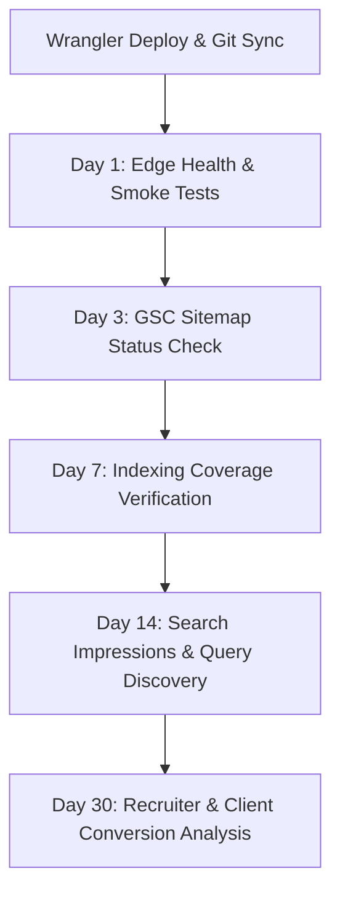

# Phase 3 — Post-Release Telemetry, Search Console & Anomaly Monitoring

**Document ID:** `docs/growth-system/19-post-release-monitoring.md`  
**Execution Date:** 2026-11-03  
**Author:** Analytics Engineer, Technical SEO Specialist, DevOps / SRE  
**Status:** Protocol Ready to Activate Post-Deployment  
**Target Domain:** `https://uzairkhatri.com`

---

## 1. Post-Release Telemetry Framework

Following the production deployment of the P0 fixes, telemetry must be monitored actively to ensure zero service degradation, verify the resolution of the Google Search Console sitemap deadlock, and track the growth of organic indexation.



---

## 2. Structured Monitoring Protocol

### Day 1: Edge Health, Live Log Tailing & Smoke Testing
- **Cloudflare Edge Metrics**:
  - Open Cloudflare Dashboard -> **Workers & Pages** -> `uzairkhatri` -> **Metrics**.
  - Check HTTP Status breakdown: Assert `2xx` >= 99.5%, `4xx` < 0.5%, `5xx` = 0%.
- **Live Worker Log Tailing**:
  - Run from terminal:
    ```bash
    npx wrangler tail
    ```
  - Test `/api/contact` and verify logs show clean JSON dispatch without runtime exceptions.
- **Header & Redirect Verification**:
  - Confirm `/book` returns `302` to Calendly with zero intermediate hops.
  - Confirm `sitemap.xml` returns `Content-Type: application/xml`.

---

### Day 3: Google Search Console Sitemap Clearance
- **Primary Objective**: Transition `sitemap.xml` status from `isPending: true` to **Success**.
- **Inspection Path**:
  - Open GSC (`sc-domain:uzairkhatri.com`) -> **Sitemaps**.
  - Inspect `sitemap.xml`:
    - **Status**: Must display `Success` (green).
    - **Discovered Pages**: Must equal **19**.
- **Troubleshooting**:
  - If status remains "Couldn't fetch", verify that `https://uzairkhatri.com/sitemap.xml` returns 200 OK via GSC URL Inspector. If blocked by Cloudflare Bot Fight Mode, whitelist Googlebot user agent.

---

### Day 7: Index Coverage & Page Crawling
- **Primary Objective**: Verify that all 4 technical articles and the `/audit/` diagnostic sprint are indexed.
- **Inspection Path**:
  - GSC -> **Indexing** -> **Pages**.
  - Check **Indexed Pages**: Expect progressive increase from baseline 6 to 19.
  - Review **Not Indexed Reasons**:
    - "Page with redirect": Ensure only `/book/` or external links appear here.
    - "Duplicate without user-selected canonical": Must be **0** (verifies that `/audit/` canonical fix worked).
    - "Crawled - currently not indexed": Monitor `/insights/*` articles; if listed, review internal link anchor text.

---

### Day 14: Search Query & Discovery Trajectory
- **Primary Objective**: Detect early impression signals for non-branded architectural queries.
- **Inspection Path**:
  - GSC -> **Performance** -> **Search Results**.
  - Filter: Last 28 Days vs Previous Period.
  - Query Filters:
    - `production ai architecture`
    - `ai agent guardrails`
    - `production rag architecture checklist`
    - `ai agent evaluation`
    - `pre-mortem engineering audit`
- **Benchmark Goal**: Baseline organic impressions were ~2-5/day. Target: > 35 impressions/day across the 4 new technical pillar queries.

---

### Day 30: Recruiter & Commercial Conversion Funnel
- **Primary Objective**: Correlate organic discovery with actual commercial business outcomes.
- **GA4 Exploration Report (`553870935`)**:
  - Dimension: `Session default channel group`, `Page path and screen class`.
  - Metrics: `Sessions`, `Engaged sessions`, `Engagement rate`, `Event count`.
  - Key Events to Track:
    - `case_study_click` (Destination: `/work/<slug>/`).
    - `booking_click` (Calendly modal activations).
    - `generate_lead` (Contact form / Audit form submissions).
- **Outcomes Ledger**:
  - Number of CV downloads (`/Uzair-Iqbal-AI-Architect-CV.pdf`).
  - Inbound consultation inquiries routed to `uz.khatri@gmail.com`.
  - Recruiter outreach citing specific architectural case studies.

---

## 3. Anomaly Escalation Protocol

| Anomaly Indicator | Root Cause Hypothesis | Remediation Action |
| :--- | :--- | :--- |
| **GSC Sitemap shows "Error" or "0 URLs"** | Cloudflare WAF or Bot Management blocking Googlebot sitemap crawler. | Verify Cloudflare Security Events for Googlebot ASN (AS15169). Create WAF skip rule for `/sitemap.xml`. |
| **Worker 500 on `/api/contact`** | Cloudflare Email Routing destination address bounce or unverified status. | Verify `uz.khatri@gmail.com` status in Cloudflare Email Routing settings; check sender domain SPF/DKIM records. |
| **`/audit/` still reported as duplicate in GSC** | Googlebot caching pre-remediation HTML with old canonical. | Submit priority re-crawl via GSC URL Inspection tool and verify live HTTP test returns corrected canonical. |
| **GA4 showing 0 events in production** | Opt-out cookie or `analytics=off` query string cached in browser. | Test in clean Incognito window; confirm GTM container and `gtag('config', 'G-1LXS5Z6GJ6')` dispatch network payloads. |

